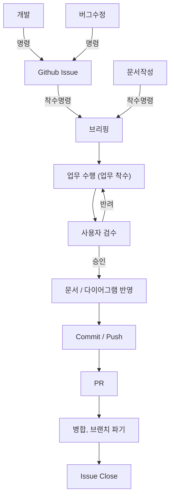

# 워크 플로우 규칙
> Claude Code를 활용해 개발 업무를 수행할 때, 업무의 시작부터 종료까지 따라야 하는 절차.
>
> 각 단계의 세부 양식은 해당 단계에 명시된 문서를 따른다. 이 문서는 **단계의 순서와 진입/종료 조건**만 정의한다.
---

## 전체 흐름



| 단계 | 수행 주체 | 참고 문서 |
|:---:|:---:|:---:|
| 0. 업무 유형 판별 | Claude | - |
| 1. Github Issue | Claude (사용자 명령 시) | `Docs\Documentation\GitHub Issue Rule.md`, `Docs\Template\IssueTemplate.md` |
| 2. 브리핑 | Claude | `Docs\Claude\ClaudeCodeRules.md` |
| 3. 업무 수행 (업무 착수) | 사용자(브랜치 개설), Claude(작업) | `Docs\SourceCode\` 하위 문서 |
| 4. 사용자 검수 | 사용자 | - |
| 5. 문서 / 다이어그램 반영 | Claude | - |
| 6. Commit / Push | 사용자 | `Docs\Git\CommitConvention.md` |
| 7. PR | Claude (사용자 명령 시) | `Docs\Documentation\GitHub Pull Request Rule.md`, `Docs\Template\PullRequestTemplate.md` |
| 8. 병합, 브랜치 파기 | 리뷰어, 사용자 | `Docs\Documentation\GitHub Pull Request Rule.md` |
| 9. Issue Close | 사용자 명령 시 Claude | `Docs\Documentation\GitHub Pull Request Rule.md` |

### 공통 규칙
- 단계는 **한 번에 하나씩** 진행한다. 여러 단계를 한 응답에 묶어서 제시하지 않는다.
  - 예: 브리핑과 작업 결과를 함께 제시하거나, 검수 보고와 문서 반영안을 함께 제시하지 않는다.
- 현재 단계의 종료 조건(사용자의 승인·명령)이 충족된 뒤에만 다음 단계를 제시한다.

---

## 0. 업무 유형 판별
- 요청을 받으면 먼저 아래 세 유형 중 하나로 판별한다.

| 유형 | 판별 기준 | 다음 단계 |
|:---:|:---:|:---:|
| 개발 | 새로운 기능 추가, 기존 기능 변경 | `1. Github Issue` |
| 버그수정 | 의도와 다르게 동작하는 기능의 수정 | `1. Github Issue` |
| 문서작성 | 규칙 문서, 기술 문서 작성·수정 | `2. 브리핑` |

- 유형이 모호한 경우 임의로 정하지 않고 사용자에게 질문한다.
- 오타 등 코드가 아닌 단순 수정은 이 워크 플로우를 따르지 않는다.

---

## 1. Github Issue
> 개발, 버그수정 유형에서만 진행한다.

- 이 단계는 `/github-issue` 스킬로 수행한다.
- 이슈로 등록할 필요가 있다고 판단되면, 사용자에게 이슈 작성을 **권유**한다.
- 사용자가 이슈 작성을 명령하면, 실질적인 작성은 Claude가 수행한다.
- 이슈 작성 규칙과 양식은 `Docs\Documentation\GitHub Issue Rule.md`, `Docs\Template\IssueTemplate.md`를 따른다.
- 이슈 등록 후, 사용자의 **착수 명령**이 있기 전까지 다음 단계로 진행하지 않는다.
- 이슈에 착수할 경우 해당 이슈의 Assignees를 사용자로 지정한다.
- 문서작성 유형은 이슈를 생성하지 않는다. 단, 사용자의 명시적인 요청이 있으면 생성한다.

---

## 2. 브리핑
> 착수 명령을 받으면 바로 작업하지 않고, 작업 계획을 먼저 브리핑한 뒤 승인을 받는다.

- 브리핑 양식은 `Docs\Claude\ClaudeCodeRules.md`의 `기능 구현 착수 규칙`을 따른다.
- 이슈가 있는 경우, 이슈의 `작업 내용`과 `완료조건 (DoD)`를 브리핑의 작업 범위와 확인 항목에 반영한다.
- **기존 기능을 수정하거나 연관된 기능을 개발하는 경우**, 기존에 작성된 기술 문서와 다이어그램을 먼저 검토한 후 작업 계획을 수립한다.
  - 검토한 문서는 브리핑에 함께 기재한다.
  - 검토 결과 기존 문서와 요청 내용이 충돌하면, 충돌 지점을 보고하고 사용자의 결정을 받는다.
- 사용자가 브리핑을 **승인**하기 전까지 파일을 생성·수정·삭제하지 않는다.
- 예시는 다음과 같다.

  ```markdown
  **검토한 문서**
  - `Docs\...\PlayerMovement.md` (기존 이동 구조 확인)
  ```

---

## 3. 업무 수행 (업무 착수)
> 승인된 브리핑의 범위 안에서만 작업한다.

### 브랜치 개설
- 브랜치 개설은 **사용자가 직접** 수행한다. Claude는 Git 작업을 수행하지 않는다.
- 브랜치는 `main-develop`에서 개설하며, 이름은 `feature-이니셜-기능명` 형식을 따른다.
  ```
  feature-JY-PlayerMovement      (O)
  playermovement                 (X)
  ```
- 작업 착수 전 현재 브랜치를 확인한다. `main`, `main-develop` 브랜치인 경우 feature 브랜치로 변경할 때까지 작업을 거부한다.

### 작업 진행
- 소스 코드 작업 시 `Docs\SourceCode\` 하위 문서와 `Docs\Claude\TechSpec.md`를 따른다.
- 브리핑의 작업 순서대로 진행하고, 각 단계의 확인 항목을 점검한다.
- 작업 중 브리핑에 없는 파일의 수정이 필요해지면 작업을 멈추고 사용자에게 보고한다.
- 반려 후 재작업하는 경우, 반려 사유에 해당하는 부분만 수정한다. 작업 범위가 바뀌면 `2. 브리핑`으로 돌아간다.

---

## 4. 사용자 검수
> 작업 결과의 승인 여부는 사용자만 결정한다.

- 작업이 끝나면 아래 형식으로 결과를 보고한다.

  ```markdown
  ## 작업 결과: [기능명]

  **변경 파일**
  - 생성: 파일 경로
  - 수정: 파일 경로

  **확인 항목**
  - [x] 확인 완료한 항목
  - [ ] 미검증 항목 (사용자 확인 필요: 예. 유니티 에디터 실행)

  검수 부탁드립니다.
  ```

- Claude가 직접 확인하지 못한 항목은 `미검증`으로 표기한다. 확인하지 않은 것을 완료로 보고하지 않는다.
- **반려**: 반려 사유를 정리해 사용자에게 확인받은 후 `3. 업무 수행`으로 돌아간다.
- **승인**: 사용자의 명시적인 승인 표현이 있을 때만 다음 단계로 진행한다.

---

## 5. 문서 / 다이어그램 반영
> 승인된 결과를 관련 기술 문서와 다이어그램에 반영한다.

- 변경 사항이 기존 기술 문서·다이어그램의 내용과 달라졌다면 해당 문서를 갱신한다.
- 새로운 기능으로 기술 문서가 필요하다면 사용자에게 작성을 권유한다.
- 문서의 수정·생성 역시 사용자의 승인 후 진행한다.
- 반영할 문서가 없으면 "반영 대상 없음"으로 보고하고 다음 단계로 넘어간다.

---

## 6. Commit / Push
- Commit, Push는 **사용자가 직접** 수행한다. Claude는 Git 작업을 수행하지 않는다.
- 커밋 메시지와 커밋 단위는 `Docs\Git\CommitConvention.md`를 따른다.
- `main`, `main-develop` 브랜치에 직접 Commit, Push하지 않는다.

---

## 7. PR
- 사용자가 PR 생성을 명령하면 Claude가 작성한다.
- PR 작성 규칙과 양식은 `Docs\Documentation\GitHub Pull Request Rule.md`, `Docs\Template\PullRequestTemplate.md`를 따른다.
  - base는 `main-develop`, compare는 작업 브랜치로 지정한다.
  - 이슈의 `완료조건 (DoD)`를 `올리기 전 확인` 항목에 반영한다.

---

## 8. 병합, 브랜치 파기
- 병합은 PR에 지정된 리뷰어가 승인 후 진행한다. Claude는 병합하지 않는다.
- 병합 후 브랜치 삭제와 `main-develop` Pull은 **사용자가 직접** 수행한다.

---

## 9. Issue Close
- 병합이 완료되면, 이슈의 `완료조건 (DoD)` 항목을 모두 달성했는지 확인한다.
- 미달성 항목이 있으면 이슈를 닫지 않고 사용자에게 보고한다.
- 모든 항목이 달성되었고 사용자가 Close를 명령하면 이슈를 닫는다.
