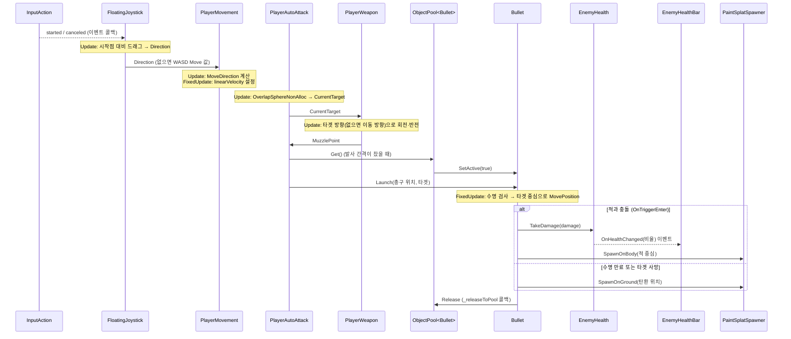

## 문서명: `261103ChoreCodeReview`

## 1. 리뷰 개요
- 일자: 2026-11-03 (화요일)
- 대상: `Assets/Scripts/` 하위 전체 11개 스크립트 (F-01 ~ F-14), 기준 커밋 `7c441ed`
- 목적: `Diagram.md`가 보여주는 **"무엇이 무엇과 연결되는가"** 에 더해, **"어떤 순서로 돌아가는가(구동 원리)"** 와 **"왜 이렇게 만들었는가(설계 이유)"** 를 기록한다.
- 관련 문서: `Diagram.md`, `261102FeatPlayerMovement.md`, `261102FeatPlayerWeapon.md`, `261102FeatEnemy.md`, `261102FeatBullet.md`
  - 기능별 "선택 이유"는 위 문서가 원본이다. 이 문서는 중복을 피하고 **문서 사이를 잇는 흐름**과 **기존 문서에 없는 이유**를 보충한다.

> 표기: 이 문서의 내용은 코드를 읽고 정리한 것이다. 에디터 실행으로 확인하지 않은 동작 설명과 6장의 질문은 모두 **미검증** 상태다.

---

## 2. 구동 원리: 한 프레임 안에서 일어나는 일

### 2-1. Unity 이벤트 함수 순서와 역할 배치
Unity는 한 프레임을 대략 `FixedUpdate(0~N회) → Update → LateUpdate → 렌더링` 순서로 처리한다. 이 프로젝트는 각 단계에 맡는 일을 다음처럼 나눴다.

| 단계 | 주기 | 담당 스크립트 | 하는 일 |
|:---:|:---:|:---|:---|
| `FixedUpdate` | 고정 간격 (기본 0.02초) | `PlayerMovement`, `Bullet` | 물리 이동 (속도 설정, `MovePosition`), 탄환 수명 계산 |
| 물리 처리 | `FixedUpdate` 직후 | Unity 물리 엔진 | 충돌 계산 → `Bullet.OnTriggerEnter` 호출 |
| `Update` | 매 렌더 프레임 | `FloatingJoystick`, `PlayerMovement`, `PlayerAnimation`, `PlayerWeapon`, `PlayerAutoAttack`, `Bullet`, `PaintSplat` | 입력 읽기, 적 탐색, 발사, 조준, 연출(깜빡임, 데칼 진행) |
| `LateUpdate` | 모든 `Update` 이후 | `CameraFollow` | 이동이 끝난 플레이어 위치로 카메라 맞추기 |

**핵심 원칙**: *입력과 판단은 `Update`, 물리는 `FixedUpdate`, 따라가는 것은 `LateUpdate`.*
- 입력은 프레임마다 들어오므로 `Update`에서 읽어야 놓치지 않는다.
- 물리 엔진은 고정 간격으로 계산하므로, 속도와 위치 변경도 그 간격(`FixedUpdate`)에 맞춰야 프레임레이트와 상관없이 일정하게 움직인다.
- 카메라는 "대상이 움직인 결과"를 따라가야 하므로 가장 마지막(`LateUpdate`)에 둔다.
- 플레이어 Rigidbody는 `Interpolate`가 켜져 있다(`New Scene.unity`). 그래서 물리 간격과 렌더 프레임이 어긋나도 `Transform`이 프레임마다 부드럽게 보간되고, `LateUpdate`의 카메라도 떨림 없이 따라갈 수 있다.

### 2-2. 핵심 루프: 입력부터 물감 자국까지



### 2-3. 객체의 생애주기 (생성 → 사용 → 반환)
탄환(`Bullet`)과 물감 자국(`PaintSplat`)은 **같은 생애주기 패턴**을 따른다.

```
[처음 한 번]  Pool.Get() → CreateXxx() → Instantiate → Initialize(Release 콜백, 필요 의존성)
[매 사용]     Pool.Get() → OnGetXxx() → SetActive(true) → Launch()/Play()로 상태 초기화
[사용 끝]     자기 자신이 _releaseToPool(this) 호출 → OnReleaseXxx() → SetActive(false)
[풀 초과]     maxSize를 넘는 반환 → OnDestroyXxx() → Destroy
```
- `Initialize`(한 번)와 `Launch`/`Play`(매번)를 나눈 이유: 재사용 객체는 **"평생 고정인 값"** 과 **"쓸 때마다 리셋해야 하는 값"** 이 다르기 때문이다. 리셋 대상(`_elapsedTime`, `_isReleased`, 트레일 등)은 반드시 `Launch`/`Play`에서 초기화한다.
- 풀(소유자)이 객체를 회수하지 않고 **객체가 스스로 반환**한다. 언제 끝나는지(명중, 수명, 연출 종료)는 객체 자신만 알기 때문이다. 대신 객체가 풀 타입을 몰라도 되도록 `Action<T>` 콜백만 받는다.

---

## 3. 공통 설계 원칙 (여러 스크립트에 반복되는 것)

| 원칙 | 적용 위치 | 이유 |
|:---|:---|:---|
| **참조는 `[SerializeField] private`로 인스펙터 연결** | 거의 모든 스크립트 | `Find`, `GetComponent` 같은 런타임 탐색 비용과 실패 가능성을 없앤다. 외부에서 값을 바꿀 수 없게 막아 캡슐화를 유지한다. |
| **읽기 전용 공개: `{ get; private set; }` / `=>`** | `Direction`, `MoveDirection`, `IsMoving`, `CurrentTarget`, `MuzzlePoint` | 다른 스크립트는 값을 **읽기만** 하고, 값을 바꾸는 책임은 소유한 스크립트 하나에만 둔다. 데이터 흐름이 한 방향이 되어 추적이 쉽다. |
| **값이 바뀔 때만 갱신 (변경 감지)** | `PlayerAnimation._wasMoving`, `PlayerWeapon._lastAimDirection`, `_currentSprite`, `EnemyHealthBar`(이벤트) | 같은 값을 매 프레임 다시 쓰는 낭비를 줄인다. 특히 `Animator.SetBool`과 Transform 변경은 내부 처리 비용이 있다. |
| **이벤트로 알리기 (Observer)** | `EnemyHealth.OnHealthChanged` → `EnemyHealthBar` | 체력은 UI가 존재하는지 모른다. UI를 빼거나 다른 반응(사운드, 이펙트)을 더해도 `EnemyHealth`를 고치지 않는다. |
| **구독 / 해제 짝 맞추기** | `OnEnable` ↔ `OnDisable` (`FloatingJoystick`, `EnemyHealthBar`, `PlayerMovement`) | 비활성화된 객체가 이벤트를 계속 받거나 InputAction이 켜진 채 남는 것을 막는다. (`TechSpec.md` 입력 규칙) |
| **단일 책임 분리** | 조이스틱 / 이동 / 애니메이션 / 무기 / 공격 / 탄환 / 스포너 / 데칼 | 스크립트 하나가 "한 가지 이유로만" 바뀌도록 한다. 예: 탄환 연출을 바꿔도 `PlayerAutoAttack`은 고치지 않는다. |
| **GC 할당 피하기** | `OverlapSphereNonAlloc` + 재사용 배열, `ObjectPool`, `static readonly` 해시/회전값, `sqrMagnitude` | 매 프레임 실행되는 코드에서 메모리 할당과 불필요한 계산을 없애 프레임 끊김(GC 스파이크)을 예방한다. |
| **매직 넘버 대신 상수 / 직렬화 필드** | `MAX_DETECT_COUNT`, `NORMAL_SCALE_Y`, `GROUND_ROTATION`, 각종 `_tune` 값 | 숫자의 의미를 이름으로 드러내고, 조정할 값은 인스펙터에서 바꾸게 한다. |

---

## 4. 스크립트별 리뷰

> 각 항목: **역할** / **구동 원리** / **설계 이유**. 기존 기술 문서에 이미 있는 이유는 `→ 참조`로만 남긴다.

### 4-1. 입력 · 이동 (F-01 ~ F-04)

#### `FloatingJoystick` — 보이지 않는 조이스틱
- **역할**: 화면을 누른 지점을 중심으로, 드래그 방향을 길이 0~1의 `Vector2`로 만든다.
- **구동 원리**
  1. `TouchPress.started` 콜백 → 누른 순간의 `TouchPosition`을 `_touchStartPosition`으로 저장
  2. `Update` → 누르고 있는 동안 `현재 위치 - 시작 위치`를 계산
     - 데드존(`_deadZoneDistance`) 미만이면 `Vector2.zero` (손떨림 무시)
     - 아니면 `_maxDragDistance`로 나누고 `ClampMagnitude(…, 1)` → 조금 끌면 천천히, 끝까지 끌면 최대 속도
  3. `TouchPress.canceled` 콜백 → `Direction = zero`
- **설계 이유**
  - "누른 순간"은 한 번만 일어나는 사건이라 **콜백**으로, "누르는 동안"은 계속되는 상태라 **`Update` 폴링**으로 처리했다. 사건과 상태를 나눠 다루는 방식이다.
  - 나눗셈 후 `ClampMagnitude`를 써서 **방향은 유지하면서 길이만 1로 제한**한다. 대각선으로 끌어도 더 빨라지지 않는다.
  - `OnDisable`에서 `Direction`을 0으로 돌려, 꺼진 조이스틱이 마지막 방향을 계속 내보내지 않게 한다.
  - UI 없음, 컴포넌트 분리 → 참조 `261102FeatPlayerMovement.md`

#### `PlayerMovement` — 이동
- **역할**: 입력을 월드 XZ 방향으로 바꿔 Rigidbody 속도로 적용한다.
- **구동 원리**: `Update`에서 조이스틱 값을 읽고 0이면 WASD(`Move`) 값을 쓴다 → `(x, 0, y)`로 변환 → `FixedUpdate`에서 `linearVelocity`의 **x, z만** 바꾸고 y는 유지한다.
- **설계 이유**
  - 조이스틱 **우선**, WASD **보조**: 모바일이 주 플랫폼이고, 에디터 테스트용 키보드는 터치가 없을 때만 쓰인다.
  - 화면 위(y) → 월드 앞(z) 대응: 카메라가 +Z 방향을 바라보고 있다(`CameraFollow._offset = (0, 8, -8)`)는 전제 위에서 성립한다.
  - y 속도를 유지하는 이유: 중력에 의한 낙하를 입력이 덮어쓰지 않게 하기 위함이다.
  - `AddForce`가 아닌 **속도 직접 설정**: 하이퍼 캐주얼 조작감은 "누르면 즉시 최고 속도, 떼면 즉시 정지"가 자연스럽다. 가속/관성이 필요 없다.
  - `MoveDirection`을 공개해 `PlayerAnimation`, `PlayerWeapon`이 **입력이 아닌 해석된 이동 방향**을 공유한다. 입력 소스가 늘어나도 소비자는 바뀌지 않는다.

#### `PlayerAnimation` — 애니메이션과 좌우 반전
- **역할**: `IsMoving`에 따라 Idle/Move 전환, 좌우 이동 방향에 따라 `flipX`.
- **설계 이유**
  - `Animator.StringToHash`를 `static readonly`로 한 번만 계산: 문자열로 파라미터를 찾는 비용을 없앤다.
  - `horizontal != 0`일 때만 반전: 위/아래로만 움직일 때 마지막 방향을 유지해야 캐릭터가 갑자기 뒤돌지 않는다.
  - 오른쪽 이동 시 반전 이유(원본 스프라이트 방향) → 참조 `261102FeatPlayerMovement.md`

#### `CameraFollow` — 카메라 추적
- **역할**: 대상 위치 + 고정 오프셋.
- **설계 이유**: 부드럽게 따라가기(Lerp)를 넣지 않고 **즉시 고정**했다. 플레이어가 화면 중앙에 항상 고정되어 조작 감각이 정확해진다. 떨림은 2-1의 Rigidbody 보간이 막는다.

### 4-2. 무기 · 공격 (F-05 ~ F-08)

#### `PlayerWeapon` — 조준, 반전, 총구
- **역할**: 조준 방향으로 WeaponPivot을 회전하고, 왼쪽을 볼 때 그래픽을 바로 세우고, 총구 위치를 스프라이트에 맞춘다.
- **구동 원리**
  1. `UpdateMuzzle`: 스프라이트가 바뀌었으면 `sprite.bounds`의 오른쪽 끝 중앙으로 `MuzzlePoint` 이동
  2. `UpdateAim`: `GetAimDirection()` → 타겟이 있으면 `타겟 중심 - 내 위치`(y 제거, 정규화), 없으면 `MoveDirection`
  3. `AimAt`: `Atan2(z, x)`로 XZ 평면 각도를 구해 `Euler(기울기, 0, 각도)` 적용, x < 0이면 Graphic `scale.y = -1`
- **설계 이유**
  - **조준 우선순위(타겟 > 이동 방향)** 를 `GetAimDirection` 한 함수에 모았다. 우선순위 규칙이 바뀌어도 이 함수만 고치면 된다.
  - `Atan2(z, x)`: 방향 벡터를 각도로 바꾸는 표준 방법이다. `Atan(z/x)`와 달리 사분면(왼쪽/오른쪽)을 구분하고 x = 0일 때도 나눗셈 오류가 없다.
  - 타겟 방향에서 `y = 0`: 적과 플레이어의 높이(피벗) 차이 때문에 총이 위아래로 기울지 않도록 평면 방향만 쓴다.
  - Pivot / Graphic 분리, `localScale.y` 반전, Euler 순서, 총구 자동 정렬 → 참조 `261102FeatPlayerWeapon.md`

#### `PlayerAutoAttack` — 타겟팅과 발사
- **역할**: 사거리 안 가장 가까운 적을 찾고, 발사 간격마다 풀에서 탄환을 꺼내 쏜다.
- **구동 원리** (`Update` 순서가 곧 규칙이다)
  1. `FindNearestEnemy`: `OverlapSphereNonAlloc`(Enemy Layer만) → 결과 중 `sqrMagnitude` 최소값 → `CurrentTarget` (없으면 null)
  2. `UpdateFireTimer`: 타이머가 간격보다 작을 때만 누적
  3. `TryFire`: 타겟이 있고 타이머가 찼으면 발사 후 0으로 리셋
- **설계 이유**
  - **타이머를 간격에서 멈춰 두는 방식**: 타겟이 없는 동안에도 "장전 완료" 상태로 대기하다가, 적이 사거리에 들어오는 순간 즉시 첫 발을 쏜다. 반응이 빠르게 느껴진다.
  - 탐색 → 타이머 → 발사 순서: 발사 직전에 갱신된 타겟을 쓰기 위함이다.
  - `sqrMagnitude`: 거리 **비교**에는 실제 거리가 필요 없다. 제곱한 값끼리 비교해도 대소 관계가 같으므로 제곱근 계산을 생략한다.
  - `LayerMask`로 Enemy만 탐색: 바닥, 탄환, 플레이어 콜라이더를 처음부터 제외해 반복문을 줄인다.
  - **풀의 소유자가 의존성을 전달**: `CreateBullet`에서 `_bulletPool.Release`와 `_paintSplatSpawner`를 `Initialize`로 넘긴다. 탄환 프리팹은 씬 객체를 직접 참조할 수 없기 때문에(프리팹 → 씬 참조 불가), 씬에 있는 쪽이 생성 시점에 넣어 준다.
  - NonAlloc, ObjectPool → 참조 `261102FeatEnemy.md`

### 4-3. 탄환 · 데칼 (F-09, F-12, F-13)

#### `Bullet` — 유도 탄환
- **구동 원리**
  - `Launch`: `transform`과 `_rigidbody` 위치를 **둘 다** 설정, 상태 리셋, `TrailRenderer.Clear()`
  - `FixedUpdate`: `TryExpire`(타겟 비활성 or 수명 초과 → 바닥 데칼 + 반환) → 아니면 `MoveTowardTarget`
  - `OnTriggerEnter`: `EnemyHealth`가 있으면 데미지 + 몸통 데칼 + 반환
  - `Update`: `Sin(시간)`을 0~1로 바꿔 두 색 사이를 `Lerp` (깜빡임)
- **설계 이유**
  - 위치를 두 곳에 설정하는 이유: 비활성 상태에서 꺼낸 Rigidbody는 `transform`만 바꾸면 물리 쪽 위치가 다음 물리 단계까지 이전 값으로 남을 수 있다. 둘을 함께 맞춰 "이전 위치에서 순간이동하며 충돌"하는 상황을 피한다.
  - `Trail.Clear()`: 재사용 시 이전 위치에서 새 위치까지 긴 잔상이 그려지는 것을 막는다. **풀링 객체는 '이전 사용의 흔적'을 지워야 한다**는 2-3의 원칙이 그대로 적용된다.
  - `TryExpire`가 `bool`을 돌려주는 이유: 반환된 탄환이 같은 `FixedUpdate`에서 이동까지 하지 않도록 바로 빠져나오기 위함이다. 이름의 `Try`가 "실패할 수 있고, 결과를 bool로 알려 준다"는 의미를 드러낸다.
  - 이동은 `MovePosition`(Kinematic): 물리 반동 없이 보간된 이동 + 트리거 판정을 얻는다.
  - 깜빡임을 `Update`에, 이동을 `FixedUpdate`에: 연출은 렌더 프레임마다, 물리는 물리 간격마다 실행한다 (2-1 원칙).
  - `_isReleased` 이중 가드, 콜라이더 중심 추적, Kinematic + Trigger → 참조 `261102FeatEnemy.md`

#### `PaintSplatSpawner` / `PaintSplat` — 물감 자국
- **구동 원리**: Spawner가 바닥(`Euler(90,0,0)`, 위→아래 투영, 깊게) 또는 몸통(카메라 회전, 얕게)을 선택해 `Play` → `PaintSplat.Update`에서 `progress = 경과 / 지속시간`(0~1) → 크기 `Lerp`, `fadeFactor = 1 - progress` → 1이 되면 스스로 반환
- **설계 이유**
  - **진행도(0~1) 하나로 모든 연출을 계산**: 크기와 투명도가 같은 값에서 나오므로 항상 동기화되고, 새 연출(색 변화 등)도 같은 `progress`로 추가할 수 있다. `Play`에서 `ApplyProgress(0)`을 바로 호출해 첫 프레임부터 올바른 상태로 보이게 한다.
  - `SpawnOnGround` / `SpawnOnBody`를 공개하고 실제 생성은 `private Spawn` 하나로 모았다. 호출하는 쪽(`Bullet`)은 "어디에 찍을지"만 말하고, 회전·깊이 같은 세부값은 Spawner만 안다.
  - Decal 선택, Spawner 분리, 투영 방향·깊이, 적 머티리얼 → 참조 `261102FeatBullet.md`

### 4-4. 적 (F-10, F-11)

#### `EnemyHealth` / `EnemyHealthBar`
- **구동 원리**: `TakeDamage` → `Mathf.Max(…, 0)`으로 음수 방지 → `OnHealthChanged?.Invoke(비율)` → 0이면 `Die`(`SetActive(false)`)
- **설계 이유**
  - 이벤트로 **절대값이 아닌 비율(0~1)** 을 보낸다. UI의 `fillAmount`가 0~1을 그대로 받으므로 UI 쪽에 계산이 필요 없고, 최대 체력이 바뀌어도 UI는 영향을 받지 않는다.
  - `(float)` 형변환: `int / int`는 정수 나눗셈이라 0 또는 1만 나온다. 한쪽을 실수로 바꿔야 비율이 계산된다.
  - 알림 → 사망 순서: 사망 전에 이벤트를 먼저 보내 게이지가 0으로 갱신된 뒤 비활성화된다.
  - `?.Invoke`: 구독자가 없을 때(null)도 안전하게 호출한다.
  - 사망 시 비활성화, 이벤트 기반 UI → 참조 `261102FeatEnemy.md`

---

## 5. 의존 방향 정리
`Diagram.md`의 화살표를 **"누가 누구를 알고 있는가"** 로 다시 읽으면 다음과 같다.

```
FloatingJoystick ← PlayerMovement ← PlayerAnimation
                                   ← PlayerWeapon ⇄ PlayerAutoAttack → Bullet → EnemyHealth ← EnemyHealthBar
                                                                            → PaintSplatSpawner → PaintSplat
```
- 대부분 **한 방향**이다. 아래쪽(데이터를 만드는 쪽: 조이스틱, 체력)은 위쪽(소비하는 쪽)을 모른다.
- 유일한 **양방향**은 `PlayerWeapon ⇄ PlayerAutoAttack` (타겟 ↔ 총구)이다. → 6장 질문 Q1과 연결된다.
- `Bullet`과 `PaintSplat`은 풀을 직접 알지 않고 `Action` 콜백만 안다. 그래서 풀을 다른 방식으로 바꿔도 두 스크립트는 고칠 필요가 없다.

---

## 6. 생각해볼 질문 (모두 미검증)
> 정답은 적지 않는다. 각 질문을 직접 확인하거나 실험해 보고, 결론과 그 근거를 이 문서나 이슈에 남겨 보자.

| ID | 위치 | 질문 | 확인 힌트 |
|:---:|:---|:---|:---|
| Q1 | `PlayerWeapon.GetAimDirection`, `PlayerAutoAttack.FindNearestEnemy` | 두 스크립트 모두 `Update`에서 실행되는데, 프로젝트에 Script Execution Order 설정이 없다. `PlayerWeapon`이 먼저 실행되면 어떤 값의 `CurrentTarget`을 읽게 될까? 같은 질문을 `FloatingJoystick` → `PlayerMovement`에도 해 보자. 이것이 눈에 보이는 문제가 되는가, 아니면 허용 가능한 수준인가? | Unity 문서 "Order of execution", `[DefaultExecutionOrder]` |
| Q2 | `EnemyHealth.Die` ↔ `PlayerWeapon` | 적이 죽어 `SetActive(false)`되면 `CurrentTarget`은 다음 탐색 전까지 그 콜라이더를 가리킨다. 비활성화된 객체는 `== null`일까? Q1의 순서에 따라 무기가 죽은 적을 한 프레임 조준할 가능성이 있는가? | `Bullet.TryExpire`는 같은 상황을 `activeInHierarchy`로 검사한다. 두 코드의 차이를 비교해 보자. |
| Q3 | `Bullet.OnTriggerEnter` | 탄환은 `_target`이 아닌 **다른 적**에게 닿아도 데미지를 준다. 의도한 게임 디자인인가? 적이 많이 몰려 있을 때 플레이어 체감은 어떻게 달라질까? | 적을 일렬로 세워 놓고 실험 |
| Q4 | `PlayerAutoAttack.MAX_DETECT_COUNT` | 사거리 안에 적이 16마리를 넘으면 `OverlapSphereNonAlloc`은 어떤 16마리를 돌려줄까? 그중에 실제로 가장 가까운 적이 항상 포함된다고 보장할 수 있는가? | `OverlapSphereNonAlloc` 반환 순서에 대한 공식 문서 설명 |
| Q5 | `EnemyHealth.Awake`, `EnemyHealthBar` | TODO에 적 풀링이 예정되어 있다. 비활성화된 적을 다시 `SetActive(true)`로 재사용하면 체력과 게이지는 어떤 값으로 시작할까? 2-3의 "Initialize / Launch 분리" 원칙을 적에게 적용한다면? | `Awake`와 `OnEnable`이 각각 언제 호출되는지 |
| Q6 | `FloatingJoystick._maxDragDistance` | 드래그 거리를 **픽셀**로 잰다. 해상도와 화면 크기가 다른 기기(태블릿 vs 소형 폰)에서 같은 손가락 이동이 같은 입력이 될까? | `Screen.dpi`, `Screen.height` |
| Q7 | `PlayerAnimation.UpdateFacing` vs `PlayerWeapon.AimAt` | 캐릭터는 **이동 방향**으로, 무기는 **타겟 방향**으로 뒤집힌다. 오른쪽으로 걸으며 왼쪽의 적을 쏘면 어떻게 보일까? 의도한 연출인가? | 에디터에서 직접 재현 |
| Q8 | `Bullet.UpdateBlink` | 모든 탄환이 같은 `Time.time`을 쓴다. 여러 발이 동시에 날아갈 때 깜빡임이 어떻게 보일까? 그것이 원하는 느낌인가? | 발사 간격을 줄여 관찰 |
| Q9 | `PlayerMovement.ReadMoveInput` | 화면 y → 월드 z 대응은 카메라가 +Z를 바라본다는 전제다. 카메라 각도(Y 회전)를 바꾸는 기획이 생기면 어떤 코드가 영향을 받을까? | `CameraFollow._offset`, 카메라 회전값 |

---

## 7. 정리
- **잘 지켜지고 있는 것**: 실행 단계별 역할 분리(Update / FixedUpdate / LateUpdate), 단일 책임 분리, 읽기 전용 공개 프로퍼티, 이벤트와 콜백을 통한 느슨한 결합, 풀링과 NonAlloc을 통한 GC 회피, 재사용 객체의 상태 리셋.
- **다음에 볼 것**: 6장의 질문 중 Q1, Q2는 **스크립트 간 실행 순서**, Q5는 **재사용 객체의 초기화 시점**, Q3·Q7·Q8은 **기획 의도 확인**에 관한 것이다. 수정이 필요하다고 판단되면 워크 플로우에 따라 이슈로 등록한다.
- 기타: `Docs/ImplementDocs/temp.md`가 빈 파일로 남아 있다 (보고만 함).
