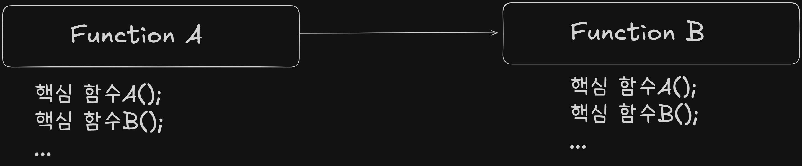

# Implement Specification Document Rule

> 목적: 코드와 문서의 싱크를 유지하는 누적형 기술 문서이다.
> 
> 기준은 3분 이내로 읽고 구조를 구현할 수 있어야 한다.

---

## 원칙

1. **Core First**: 핵심 루프와 필수 기능만 기록한다. 만일 부가 기능과 아이디어가 있다면 `TODO`를 가장 하단에 신설해 한 줄로만 남긴다.
2. **Why > What**: 코드를 보면 알 수 있는 것(What)은 줄이고, 결정 이유(Why)와 위치(Where)를 남긴다.
3. **Single Source**: 수치는 코드/데이터 파일이 원본이다. 문서에는 값 자체보다 **파일 경로**를 우선 적는다.

---

## 문서 구조

### 기술 문서 파일 이름: `YYMMDD 타입 구현 내용.md`
- 파일 이름에서의 스페이스는 구분을 위한 것이고 실질적으로는 붙일 것. 
- 브랜치 이름을 활용해 타입, 구현 내용을 채울 것.

### 1. 구현 일자
- 일자: YYYY-MM-DD (X요일) 

### 2. Core Contents
- 구현 방향: (예) MapData(JSON) → MapLoader → GridMap
- (구현을 통한) 목표:

### 3. ID 기능 (예: F-05 플레이어 이동 범위)
- What : 어떤 것을 구현?
- Where: `폴더 경로/스크립트.cs`
- Tune : 지형별 이동 비용, 유닛 이동력

## 4. 선택 이유
- 이것을 구현함에 있어 왜 이 설계로 진행하였는가의 이유를 적는다.

## 5. Features 목록 
- 이 부분만 기능 구현 후 표를 항상 갱신한다.
- 예시는 다음과 같다.
  - ID: 구현 인식번호. 예시로는 `F-01`.
  - 기능: `이동 범위 표시`, `적 AI 점수화` 같이 15자 이내
  - 사용처: `적 페이즈에서 이동×무장×대상 조합 중 최고점 선택`와 같이 좀 더 상세하게 적을 수 있도록. 30자 이내.
  - 핵심 위치: 스크립트 폴더 경로

---

## 다이어그램 도식화
- 하나의 파일을 가지고 하나의 구현마다 최신화하여 갱신.
- mermaid를 통해 그려지도록 진행.
- 예시는 다음과 같음. 

